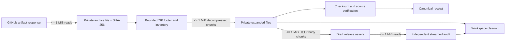

# Phase D Capacity Architecture

## Scope

Phase D admits release artifacts, verifies checksums and source provenance, stages a receipt, uploads release assets, and independently audits the published bytes. Candidate artifacts remain inert throughout admission. This change bounds those paths with file-backed staging and streaming hashes; it does not change the Publisher activation guard or operational size limits.

## Resource contract

Operational limits remain the existing values in `scripts/release_promotion.py`:

| Resource | Operational ceiling |
| --- | ---: |
| Each Actions ZIP archive | 256 MiB |
| Each expanded entry | 256 MiB |
| All expanded entries per operation | 512 MiB |
| Temporary disk for archives and staged entries | 1,024 MiB |
| Copy and hash buffer | 1 MiB |
| Processing deadline | 20 minutes |
| Concurrent operations / open archives | 1 / 1 |
| Outer archive entries / source entries | 6 / 4,999 |
| ZIP directory / extraction depth | 64 KiB / 1 |

`CapacityPolicy` is immutable. `promote()` requires exact equality with the operational policy before its first transport call. The local stress profile raises those ceilings only for fixture generation and parser benchmarks; it cannot be selected through environment variables, workflow inputs, release metadata, or Publisher arguments.

The live Publisher workflow serializes promotion runs with its `protected-release-promotion` concurrency group. Each promotion process also uses one workspace and one open archive at a time.

The stress fixture uses a 512 MiB Windows payload and a 256 MiB Linux payload. Its local-only envelope allows 768 MiB outer archives, 512 MiB entries, 1 GiB expanded data, and 2.5 GiB temporary storage to account for package sidecars and both downloaded archives. The fixture is deterministic SHAKE-256 output generated in chunks and is not an executable or a publishable release.

## Bounded data paths

- `ArtifactWorkspace.download()` passes a bounded sink to the transport. The transport reads response bytes in chunks and the sink checks actual size, aggregate disk, digest, and deadline while writing.
- `_archive_footer()` checks the ZIP end record, entry count, directory size, split-disk and ZIP64 status before `zipfile` builds its directory table.
- ZIP entries are extracted with `ZipFile.open()` into disk-backed files. The parser checks exact names, case-folded duplicates, path depth, compression type, symlink/encryption flags, per-entry size, and aggregate decompressed size.
- `checked_files()`, `ArtifactFile.verify()`, source ZIP verification, receipts, and audit assets hash files incrementally. Release asset uploads use `HTTPSConnection.send()` with bounded chunks and recheck the digest while sending.
- `promote()` owns the workspace through admission, owner gates, upload and recovery, then closes it. `FrozenArtifacts` shares that workspace with its cached artifact observation. The independent release audit owns and closes a separate workspace.

## Service and runner constraints

GitHub's current hosted runner reference lists 4 vCPU, 16 GB RAM and 14 GB SSD for public standard `ubuntu-24.04` and `windows-2025` runners. Private standard runners have 2 vCPU and 8 GB RAM. Artifact retention and storage quotas depend on plan; the API exposes artifact `size_in_bytes`, digest and a ZIP download URL, so this implementation verifies the streamed bytes against those values. GitHub releases limit each asset to less than 2 GiB; the operational Phase D limit remains lower.

- [GitHub-hosted runners reference](https://docs.github.com/en/actions/reference/runners/github-hosted-runners)
- [GitHub Actions limits](https://docs.github.com/en/actions/reference/limits)
- [Actions artifacts REST API](https://docs.github.com/en/rest/actions/artifacts?apiVersion=2026-03-10)
- [About releases](https://docs.github.com/en/repositories/releasing-projects-on-github/about-releases)

## Known limits

The local benchmark simulates file transfer and ZIP processing. It does not measure GitHub's artifact service, real network throughput, a hosted runner's disk cache, owner-attested evidence, or an actual draft release. Increasing the operational ceilings requires separate capacity review and changes; the local stress policy does not authorize that increase.
